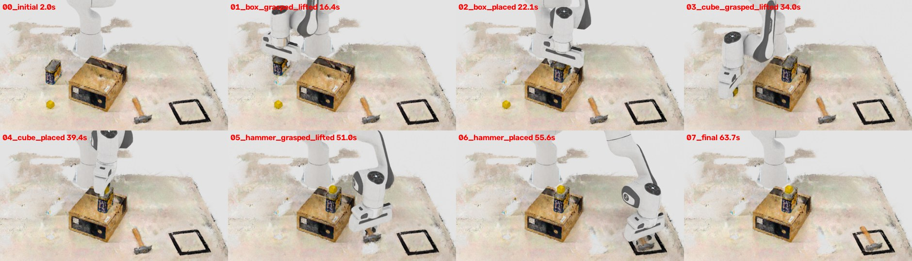

# 3DGS Digital Twin — Isaac Sim version

A high-fidelity digital twin framework for robotic manipulation, built on **3D Gaussian Splatting (3DGS)**. This repository implements the perception-to-planning-to-execution pipeline described in:

> **"A High-Fidelity Digital Twin for Robotic Manipulation Based on 3D Gaussian Splatting"**

This branch (`issacsim-version`) runs the digital twin in **NVIDIA Isaac Sim 6.1** instead of Unity. The 3DGS reconstruction is rendered as the visual layer, the collision meshes from the pipeline become invisible PhysX rigid bodies, and a Franka Panda performs closed-loop pick and place through ROS 2, MoveIt 2 and MoveIt Task Constructor (MTC). The reconstruction pipeline (Steps 0–3) is the same as on `main`.



---

## Overview

```
Sparse RGB Images
       │
       ▼
┌─────────────────────┐
│  InstantSplat (ext) │  ← 3DGS reconstruction (~229 s)
└─────────────────────┘
       │  point_cloud.ply + cameras.json
       ▼
┌─────────────────────┐
│  Step 1 · SAM       │  ← Interactive 2D segmentation
│  Segmentation       │     saves JSON polygon masks
└─────────────────────┘
       │  masks_json/
       ▼
┌─────────────────────┐
│  Step 2 · Semantic  │  ← Multi-view voting + KNN
│  Fusion             │     boundary refinement
└─────────────────────┘
       │  object.ply
       ▼
┌─────────────────────┐
│  Step 3a · Filter   │  ← Opacity + scale pruning
│  Step 3b · DBSCAN   │  ← Connectivity pruning
│  Step 3c · Mesh     │  ← Alpha Shapes → .obj
└─────────────────────┘
       │  object.ply (splats) + object.obj (collision mesh)
       ▼
┌─────────────────────┐
│  Sim export         │  ← metric scale, robot-base frame,
│  (src/sim_export)   │     colliders, targets, MTC task file
└─────────────────────┘
       │  output/twin_res5/
       ▼
┌─────────────────────┐        ROS 2         ┌──────────────────────┐
│  Isaac Sim 6.1      │  ◄─────────────────► │  MoveIt 2 + MTC      │
│  splats + PhysX     │  joint trajectories, │  (mtc_dynamic)       │
│  ros2_control       │  object poses        │  pick-and-place plan │
└─────────────────────┘                      └──────────────────────┘
```

---

## Repository Structure

```
3DGS-Digital-Twin/
├── pipeline.py                   # Steps 1–3 orchestration
├── requirements.txt
├── configs/
│   ├── default.yaml              # Reconstruction pipeline parameters
│   └── twin_res5.yaml            # Isaac twin export: calibration, objects, targets
├── src/
│   ├── semantic_segmentation/
│   │   └── sam_segmentation.py   # Interactive SAM segmentation → JSON masks
│   ├── semantic_fusion/
│   │   └── fusion.py             # Multi-view voting + KNN 3D lifting
│   ├── geometry_refinement/
│   │   ├── filter.py             # Opacity + scale attribute filtering
│   │   ├── dbscan_clean.py       # DBSCAN connectivity pruning / splitting
│   │   └── meshing.py            # Alpha Shapes meshing
│   └── sim_export/
│       └── export.py             # 3DGS scene → Isaac Sim assets + MTC task file
├── tools/
│   └── unity_gs_to_ply.py        # Unity GaussianSplatting .asset → 3DGS PLY
├── simulation/
│   └── isaac/                    # Isaac Sim scene, runtime, run report
├── ros2_ws/
│   └── mtc_controller_final/     # mtc_dynamic: MoveIt 2 Task Constructor ROS 2 package
├── docker/
│   └── moveit/                   # ROS 2 Jazzy + MoveIt 2 + MTC image
├── scripts/
│   └── run_twin_demo.sh          # End-to-end twin demo
├── tests/                        # Self-checks (python -m tests.<name>)
├── docs/
│   └── isaac_twin_contract.md    # Twin frames, file formats, ROS interface
├── external/
│   ├── InstantSplat/             # 3DGS reconstruction (submodule)
│   ├── UnityGaussianSplatting/   # Unity 3DGS renderer (submodule, original Unity runtime)
│   └── ros2-for-unity/           # ROS2ForUnity plugin (submodule, original Unity runtime)
└── data/
    └── real_env_video.mp4        # Sample real-robot environment video
```

---

## Installation

```bash
git clone -b issacsim-version https://github.com/535A59/3DGS-Digital-Twin.git
cd 3DGS-Digital-Twin

# Only needed for 3DGS reconstruction (Step 0):
git submodule update --init external/InstantSplat

pip install -r requirements.txt
```

Segmentation (Step 1) also needs SAM:

```bash
pip install git+https://github.com/facebookresearch/segment-anything.git
wget https://dl.fbaipublicfiles.com/segment_anything/sam_vit_h_4b8939.pth
```

The Isaac twin additionally needs Docker with an NVIDIA GPU and the
`nvcr.io/nvidia/isaac-sim:6.1.0` image from NGC. The MoveIt image is built from
`docker/moveit/Dockerfile` (on top of `ros:jazzy`) the first time it is used. No ROS
installation on the host is required.

---

## Isaac Sim Digital Twin

The demo reproduces the paper's pick-and-place task (Sec. 4.1.1) on the RES5 scene:
**box → on the cardboard box, cube → on the placed box, hammer → into the tape frame**.

- **Visuals.** Each object's 3DGS splats are parented to its rigid body and move with it; the background
  splats are static.
- **Physics.** The collision meshes from `src/geometry_refinement` are invisible PhysX colliders with gravity
  and contact. Grasps are physical: the fingers hold the object by friction, nothing is attached.
- **Control.** The Franka runs on `isaacsim.ros2.control` inside Isaac Sim. MoveIt 2 + MTC run in a second
  container, read the live object poses Isaac publishes and send joint trajectories back.
- **Frames.** World frame = robot base `panda_link0`, Z-up, metres. The full interface (frames, file formats,
  ROS topics) is in [docs/isaac_twin_contract.md](docs/isaac_twin_contract.md).

### Input data

The twin is built from the RES5 reconstruction, which is not distributed with the repository.
`configs/twin_res5.yaml` reads it from `data_root` (default `old_code-data/3dgs_resource/`):

| File | Used for |
|------|----------|
| `mesh_source/object{1,2,3}-copy.ply` | Segmented object splats (box, hammer, cube) |
| `GSreal2sim2real/Assets/GaussianAssets/background-copy-cl.*` | Background (table, cardboard box, frame), decoded with `tools/unity_gs_to_ply.py` |
| `3dgs/RES5/arm.ply` | Robot-base splats, calibration check only |

### Run

```bash
# export -> Isaac Sim -> MoveIt/MTC -> recording + report, about 2.5 min
ROS_DOMAIN_ID=64 PYTHON=python3 scripts/run_twin_demo.sh

# the two recorded cameras side by side (scene camera | top view)
ffmpeg -i output/twin_res5/recording/unity_main.mp4 -i output/twin_res5/recording/top.mp4 \
    -filter_complex hstack -c:v libx264 -pix_fmt yuv420p output/twin_res5/side_by_side.mp4
```

`ROS_DOMAIN_ID` must be set and non-zero; the scripts refuse domain 0. Outputs go to `output/twin_res5/`:

| Output | Content |
|--------|---------|
| `manifest.json`, `collision/`, `splats/`, `usd/` | Exported scene |
| `mtc_task.yaml` | Task parameters for `mtc_dynamic` |
| `isaac.log`, `mtc.log` | Logs of both containers |
| `recording/{unity_main,top}.mp4` | Recorded cameras (10 fps) |
| `final_state.json`, `body_poses.json` | Final poses, contacts, pose history |
| `report.json` | Per-object placement error, tilt, support and success |

Each stage can also run on its own:

```bash
python -m src.sim_export.export --config configs/twin_res5.yaml               # assets + mtc_task.yaml
ROS_DOMAIN_ID=64 simulation/isaac/run_isaac.sh --seconds 600                  # Isaac Sim container
ROS_DOMAIN_ID=64 docker/moveit/run_mtc.sh $PWD/output/twin_res5/mtc_task.yaml # MoveIt + MTC container
python simulation/isaac/twin_report.py --out_dir output/twin_res5 --config configs/twin_res5.yaml
```

A physics and rendering check without ROS: `ROS_DOMAIN_ID=64 simulation/isaac/run_isaac.sh --no_ros --drop 0.05 --seconds 4`.

### Calibration

`configs/twin_res5.yaml` keeps the robot-base position and rotation of the paper's Unity alignment, levels
the table to +Z, and replaces Unity's scale of 2.27 with a metric 1.75 m/unit, anchored on the 2.5 cm cube.
The supporting measurements are listed under `calibration_notes` in that file.

### Simulation settings beyond the paper

These were added to make the simulation stable; they are not part of the paper's method:

- a torsional friction patch on the object colliders;
- each body's origin and centre of mass at its collider centroid, assuming uniform density;
- the cardboard lid (5 mm) and the box bottom (10 mm) flattened;
- masses: box 0.15 kg, cube 0.01 kg, hammer 0.12 kg;
- a raised finger drive force.

### Results

Three consecutive full runs on an NVIDIA GB10 (aarch64), each with physical grasps and no unexpected contacts.
Values are the horizontal error to the target and the final tilt. Pass thresholds: 30 mm horizontal,
15 mm vertical, 15° tilt.

| Run | box → cardboard | cube → box | hammer → frame |
|-----|-----------------|------------|----------------|
| I | 6.6 mm, 0° | 1.4 mm, 2.2° | 3.2 mm |
| J | 5.5 mm, 0° | 1.6 mm, 2.2° | 3.5 mm |
| K | 2.4 mm, 0° | 1.0 mm, 2.2° | 3.3 mm |

### Known limitations

- The cube ends 5–6 mm low with a 2.2° tilt, and the box can rotate up to about 5.7° in the gripper.
- The hammer is judged by the 30 mm horizontal tolerance, not by the frame outline.
- `move_group` segfaults at shutdown, after "Execution complete"; this does not affect the run.
- `launch/run.launch.py` (the Unity entry point) still uses the old `panda_config.yaml` parameters.

### Self-checks

```bash
python -m tests.test_sim_export    # the last two checks need the RES5 input data
python -m tests.test_twin_report
```

---

## Reconstruction Pipeline (Steps 0–3)

### 1. Reconstruct with InstantSplat (Step 0)

Follow the [InstantSplat README](external/InstantSplat/README.md) to reconstruct a scene from sparse RGB images. This produces:
- `point_cloud.ply` — 3DGS Gaussian point cloud
- `cameras.json`    — Calibrated camera parameters

### 2. Configure the pipeline

Copy `configs/default.yaml` and fill in your paths:

```yaml
ply:          /path/to/point_cloud.ply
cameras_json: /path/to/cameras.json
images_dir:   /path/to/images/
mask_dir:     /path/to/masks_json/
out_dir:      /path/to/output/
object_name:  hammer
sam_checkpoint: sam_vit_h_4b8939.pth
```

### 3. Run the full pipeline

```bash
python pipeline.py --config configs/default.yaml
```

This runs all three steps and saves:
- `output/segmented/hammer.ply`       — Segmented 3DGS point cloud
- `output/refined/hammer_filtered.ply` — After opacity/scale filtering
- `output/refined/hammer_clean.ply`    — After DBSCAN pruning
- `output/refined/hammer.obj`          — Final collision mesh

### 4. Run individual steps

```bash
# Step 1 only (interactive segmentation window will open):
python pipeline.py --config configs/default.yaml --steps 1

# Steps 2 and 3 only (if masks already exist):
python pipeline.py --config configs/default.yaml --steps 2,3

# Step 3 only (if segmented PLY already exists):
python pipeline.py --config configs/default.yaml --steps 3
```

---

## Module Reference

### `src/semantic_segmentation`

Interactive SAM-based 2D segmentation. Opens a window per image:
- **Left click** — add foreground point
- **Right click** — add background / exclusion point
- **`s` / Space** — save current mask as JSON polygon file
- **`z`** — undo last point
- **`n`** — next image
- **`q`** — quit

```bash
python -m src.semantic_segmentation.sam_segmentation \
    --input_folder  /path/to/images \
    --output_folder /path/to/masks_json \
    --sam_checkpoint sam_vit_h_4b8939.pth
```

### `src/semantic_fusion`

Lifts 2D masks into 3D via multi-view voting and iterative KNN refinement.

```bash
python -m src.semantic_fusion.fusion \
    --ply          /path/to/point_cloud.ply \
    --cameras_json /path/to/cameras.json \
    --images_dir   /path/to/images \
    --mask_dir     /path/to/masks_json \
    --out_dir      /path/to/output \
    --object_name  hammer
```

### `src/geometry_refinement`

**Stage 3a — Attribute filter:**

```bash
python -m src.geometry_refinement.filter \
    --input  /path/to/object.ply \
    --output /path/to/object_filtered.ply \
    --min_alpha 0.05 --max_scale 0.007
```

**Stage 3b — DBSCAN clean** (keep largest cluster):

```bash
python -m src.geometry_refinement.dbscan_clean clean \
    --input  /path/to/object_filtered.ply \
    --output /path/to/object_clean.ply \
    --eps 0.01 --min_samples 50
```

**Stage 3b — DBSCAN split** (save each cluster separately):

```bash
python -m src.geometry_refinement.dbscan_clean split \
    --input   /path/to/object_filtered.ply \
    --out_dir /path/to/clusters/ \
    --eps 0.05 --min_samples 50
```

**Stage 3c — Meshing:**

```bash
python -m src.geometry_refinement.meshing \
    --input  /path/to/object_clean.ply \
    --output /path/to/object.obj \
    --alpha  0.01
```

The CLI keeps the mesh in the frame of the input PLY (`pipeline.py` centres it, as set in
`configs/default.yaml`). Every mesh gets a `<mesh>.json` sidecar with the centring offset, so it
can be put back into the splat frame. `transform_coords` is the legacy Unity axis swap; it is a
mirror (det −1) and must not be used for Isaac Sim or ROS.

### `src/sim_export`

Builds the Isaac Sim asset folder (`manifest.json`, splats, body-frame collision meshes,
static colliders, targets, camera, `mtc_task.yaml`) from an export config:

```bash
python -m src.sim_export.export --config configs/twin_res5.yaml [--out_dir output/twin_res5]
```

### `tools/unity_gs_to_ply.py`

Decodes a UnityGaussianSplatting `.asset` back into a 3DGS PLY. The rotation field of the
original assets is corrupted; the decoder repairs it (median error about 20–25°).

```bash
python tools/unity_gs_to_ply.py \
    --asset  .../GaussianAssets/background-copy-cl.asset \
    --output /path/to/background.ply
```

---

## ROS 2 / MoveIt 2 (`mtc_dynamic`)

`ros2_ws/mtc_controller_final/` contains the `mtc_dynamic` package, which plans collision-aware
pick and place with MoveIt 2 Task Constructor. On this branch it targets **ROS 2 Jazzy / MoveIt 2.12**:

- The task is an ordered list of objects read from parameters: mesh, pose and target topics,
  grasp offset and yaw, finger closing width, and approach and lift ranges. The export generates
  them as `mtc_task.yaml`; an example is in `config/twin_task.example.yaml`.
- Static obstacles (table, cardboard box) are loaded as mesh collision objects.
- The object pose is re-read before each pick, so each pick plans from the object's current pose.

It is built inside the MoveIt image; `docker/moveit/run_mtc.sh` builds the image and runs:

```bash
ros2 launch mtc_dynamic isaac.launch.py task:=/abs/path/output/twin_res5/mtc_task.yaml
```

`isaac.launch.py` starts `robot_state_publisher`, `move_group` and the controller spawners for Isaac's
`controller_manager`, then `pick_place_demo`, all on sim time. The original entry points
(`demo.launch.py`, `run.launch.py`) are still in `launch/`.

---

## Original Unity Runtime

The paper's experiments used Unity with the [UnityGaussianSplatting](external/UnityGaussianSplatting/)
renderer and [ROS2ForUnity](external/ros2-for-unity/):

1. Import `object.obj` into a Unity project.
2. Add a `MeshCollider` component (enable **Convex** for physics simulation).
3. Add a `Rigidbody` component.
4. Bridge Unity ↔ ROS 2 with ROS2ForUnity for sensor simulation and command execution.

The Unity project itself is not part of this branch.

---

## Parameter Tuning Guide

| Parameter | Default | Effect |
|-----------|---------|--------|
| `vote_fraction` | 0.5 | Lower → more permissive object mask |
| `knn_k` | 15 | Higher → smoother boundary |
| `knn_threshold` | 0.6 | Lower → more boundary updates |
| `filter.min_alpha` | 0.05 | Lower → keep more transparent Gaussians |
| `filter.max_scale` | 0.007 | Higher → keep larger Gaussians |
| `dbscan.eps` | 0.01 | Higher → merge nearby clusters |
| `meshing.alpha_value` | 0.01 | Higher → coarser / fewer holes in mesh |

The Isaac twin's export parameters (scale, meshing, masses, grasp settings) are documented
in `configs/twin_res5.yaml`.

---

## Performance (from paper)

| Metric | This system | NeRF baseline |
|--------|------------|---------------|
| Reconstruction time | ~229 s | ~1123 s |
| PSNR | 37.03 dB | 28.33 dB |
| SSIM | 0.9821 | 0.9037 |
| Pick-and-place success | **90%** (9/10) | — |

---

## License

This project builds on several open-source works:
- [3D Gaussian Splatting](https://github.com/graphdeco-inria/gaussian-splatting) — Inria / MPI
- [InstantSplat](https://github.com/NVlabs/InstantSplat) — NVIDIA
- [Segment Anything Model](https://github.com/facebookresearch/segment-anything) — Meta AI
- [Open3D](https://github.com/isl-org/Open3D) — Intel ISL
- [UnityGaussianSplatting](https://github.com/aras-p/UnityGaussianSplatting) — Aras Pranckevičius
- [MoveIt 2](https://github.com/moveit/moveit2) and [MoveIt Task Constructor](https://github.com/moveit/moveit_task_constructor) — the MoveIt project

NVIDIA Isaac Sim is used under its own license terms and is not redistributed here.
